# Mapeo de textos — Landing dev.fondea.pe

<!-- Este documento recorre la página principal de https://dev.fondea.pe/ de arriba hacia abajo. Cada sección incluye:

1. **Captura** de cómo se ve hoy en el ambiente de desarrollo.
2. **Texto actual** que está cargado (referencia).
3. **Texto final** — espacio en blanco para que el cliente escriba el copy definitivo que debe ir en esa sección.

> Instrucciones para el cliente: no es necesario tocar el diseño ni el HTML, solo completar la columna "Texto final" de cada sección con la redacción que quieren que aparezca. Si una sección no necesita cambios, pueden escribir "Se mantiene igual". -->

---

## 1. Hero / Banner principal

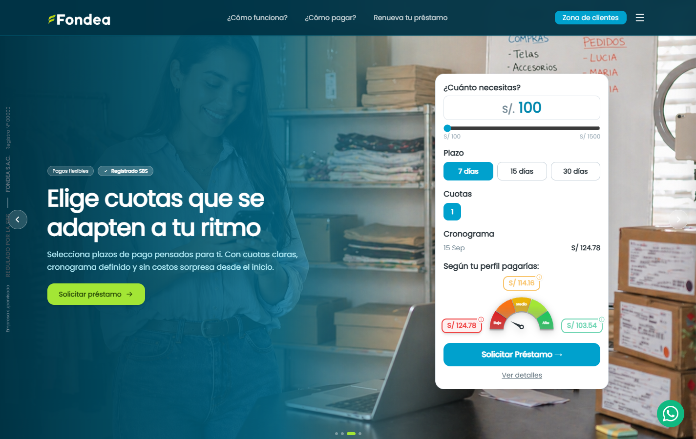

**Texto actual:**
- Badges: `Pagos flexibles` · `Registrado SBS`
- Título: "Elige cuotas que se adapten a tu ritmo"
- Descripción: "Selecciona plazos de pago pensados para ti. Con cuotas claras, cronograma definido y sin costos sorpresa desde el inicio."
- Botón: "Solicitar préstamo"

> Nota: el hero es un carrusel de 4 slides, esta captura muestra uno de ellos. Si se requiere, se puede documentar cada slide por separado.

**Texto final:**
```
(completar aquí)
```

---

## 2. Bienvenido a FONDEA / Nosotros

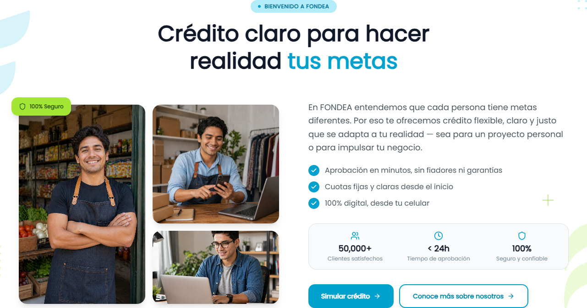

**Texto actual:**
- Eyebrow: "Bienvenido a FONDEA"
- Título: "Crédito claro para hacer realidad tus metas"
- Párrafo: "En FONDEA entendemos que cada persona tiene metas diferentes. Por eso te ofrecemos crédito flexible, claro y justo que se adapta a tu realidad — sea para un proyecto personal o para impulsar tu negocio."
- Bullets: "Aprobación en minutos, sin fiadores ni garantías" / "Cuotas fijas y claras desde el inicio" / "100% digital, desde tu celular"
- Métricas: "50,000+ Clientes satisfechos" · "< 24h Tiempo de aprobación" · "100% Seguro y confiable"
- Botones: "Simular crédito" / "Conoce más sobre nosotros"

**Texto final:**
```
(completar aquí)
```

---

## 3. Nuestros Beneficios

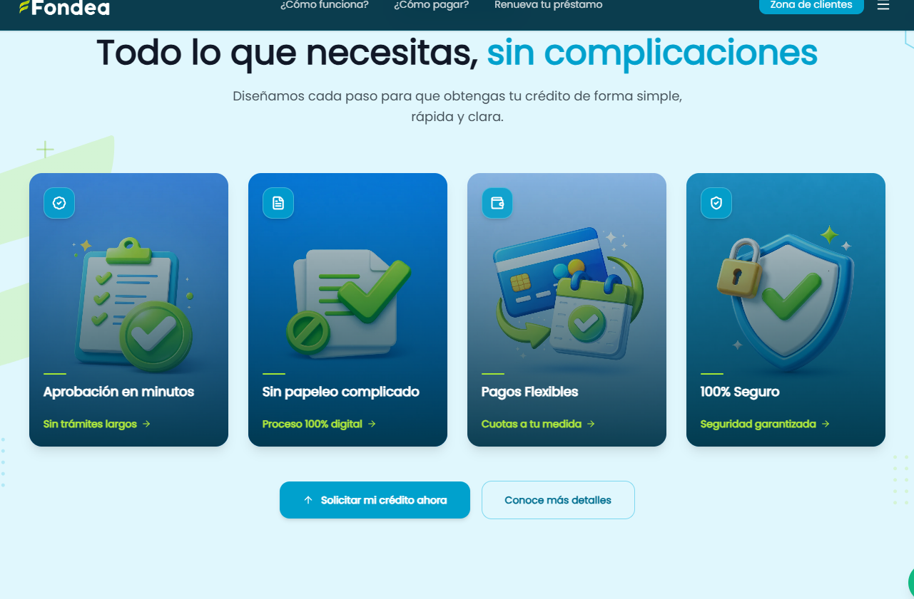

**Texto actual:**
- Eyebrow: "Nuestros Beneficios"
- Título: "Todo lo que necesitas, sin complicaciones"
- Subtítulo: "Diseñamos cada paso para que obtengas tu crédito de forma simple, rápida y clara."
- Tarjeta 1: "Aprobación en minutos" — "Respuesta rápida, sin esperas ni trámites largos" — tag "Sin trámites largos"
- Tarjeta 2: "Sin papeleo complicado" — "Solo tu DNI y una cuenta bancaria a tu nombre" — tag "Proceso 100% digital"
- Tarjeta 3: "Pagos Flexibles" — "Tú eliges el plazo que mejor se ajuste a tu capacidad de pago" — tag "Cuotas a tu medida"
- Tarjeta 4: "100% Seguro" — "Protegemos tus datos y tu dinero" — tag "Seguridad garantizada"
- Botones: "Solicitar mi crédito ahora" / "Conoce más detalles"

**Texto final:**
```
(completar aquí)
```

---

## 4. Requisitos

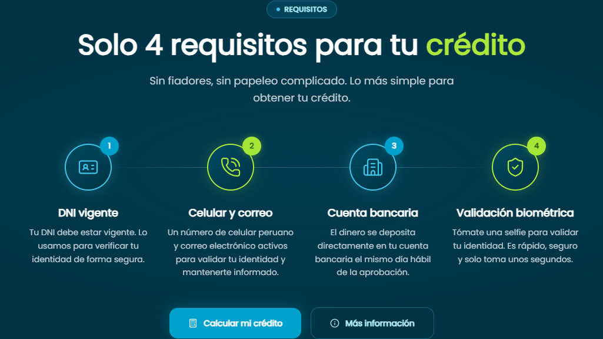

**Texto actual:**
- Eyebrow: "Requisitos"
- Título: "Solo 4 requisitos para tu crédito"
- Subtítulo: "Sin fiadores, sin papeleo complicado. Lo más simple para obtener tu crédito."
- Paso 1: "DNI vigente" — "Tu DNI debe estar vigente. Lo usamos para verificar tu identidad de forma segura."
- Paso 2: "Celular y correo" — "Un número de celular peruano y correo electrónico activos para validar tu identidad y mantenerte informado."
- Paso 3: "Cuenta bancaria" — "El dinero se deposita directamente en tu cuenta bancaria el mismo día hábil de la aprobación."
- Paso 4: "Validación biométrica" — "Tómate una selfie para validar tu identidad. Es rápido, seguro y solo toma unos segundos."
- Botones: "Calcular mi crédito" / "Más información"

**Texto final:**
```
(completar aquí)
```

---

## 5. Cómo Funciona

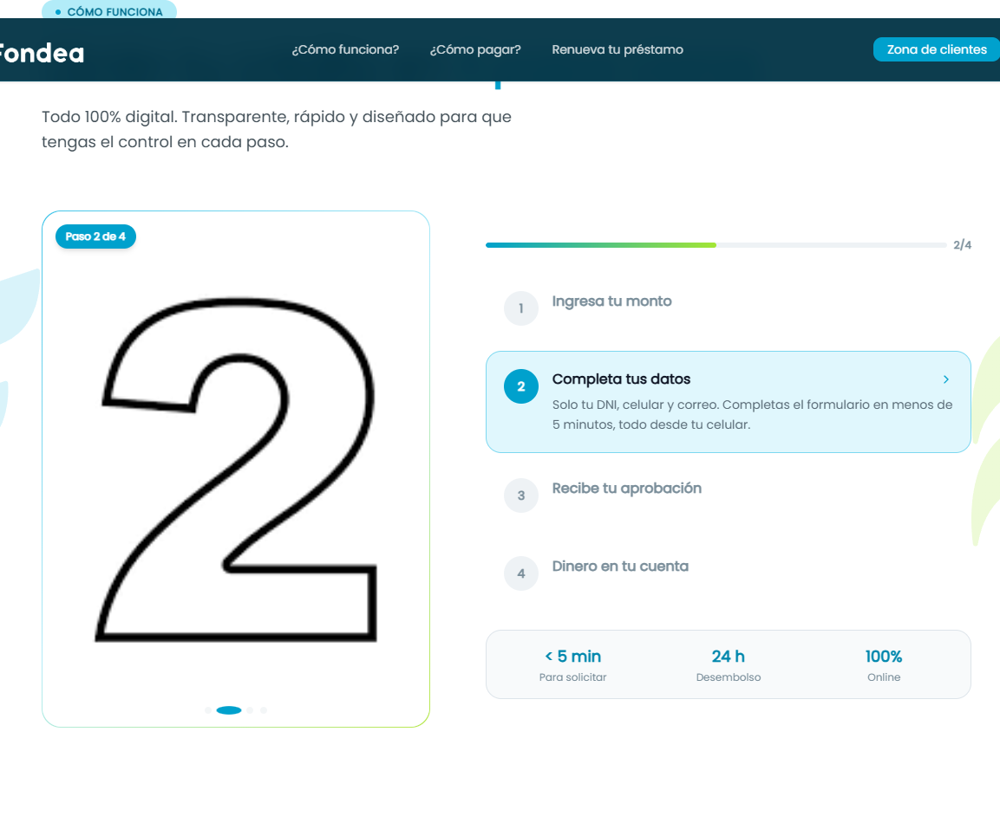

**Texto actual:**
- Eyebrow: "Cómo Funciona"
- Título: "Obtén tu crédito en 4 pasos claros"
- Subtítulo: "Todo 100% digital. Transparente, rápido y diseñado para que tengas el control en cada paso."
- Paso 1: "Ingresa tu monto" — "Elige el monto que necesitas y en cuántas cuotas quieres pagarlo. El simulador te muestra la cuota exacta y el costo total antes de comprometerte."
- Paso 2: "Completa tus datos" — "Solo tu DNI, celular y correo. Completas el formulario en menos de 5 minutos, todo desde tu celular."
- Paso 3: "Recibe tu aprobación" — "Evaluamos tu solicitud automáticamente en minutos. Recibes la respuesta con las condiciones claras de tu crédito."
- Paso 4: "Dinero en tu cuenta" — "Aceptas las condiciones, firmas digitalmente y el dinero llega a tu cuenta el mismo día hábil. Sin filas, sin visitas al banco."
- Métricas: "< 5 min Para solicitar" · "24 h Desembolso" · "100% Online"
- Botones: "Solicitar mi crédito" / "Más información"

**Texto final:**
```
(completar aquí)
```

---

## 6. Métodos de Pago

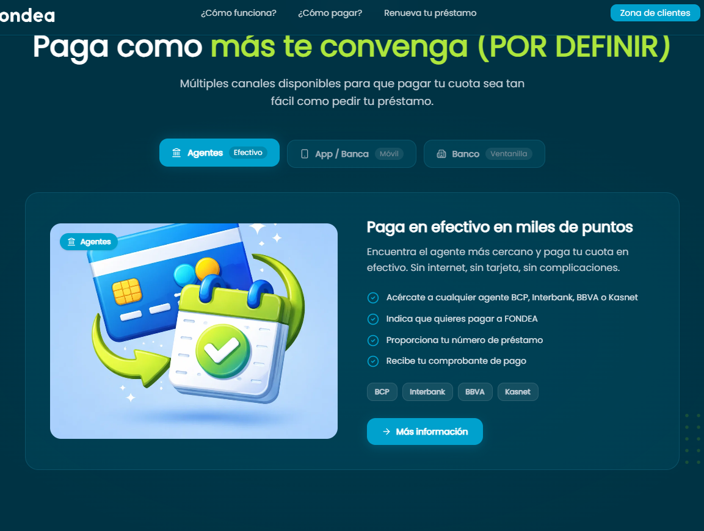

**Texto actual:**
- Eyebrow: "Métodos de Pago"
- Título: "Paga como más te convenga **(POR DEFINIR)**" ⚠️ *placeholder pendiente de texto final*
- Subtítulo: "Múltiples canales disponibles para que pagar tu cuota sea tan fácil como pedir tu préstamo."
- Tabs: "Agentes / Efectivo" · "App / Banca Móvil" · "Banco / Ventanilla"
- Contenido tab "Agentes": "Paga en efectivo en miles de puntos" — "Encuentra el agente más cercano y paga tu cuota en efectivo. Sin internet, sin tarjeta, sin complicaciones."
  - Pasos: "Acércate a cualquier agente BCP, Interbank, BBVA o Kasnet" / "Indica que quieres pagar a FONDEA" / "Proporciona tu número de préstamo" / "Recibe tu comprobante de pago"
  - Logos: BCP, Interbank, BBVA, Kasnet
- Botón: "Solicitar mi préstamo"

⚠️ **Esta sección tiene un título marcado explícitamente como "POR DEFINIR" en el sitio — es prioritaria para que el cliente la complete.**

**Texto final:**
```
(completar aquí)
```

---

## 7. Por Qué Elegirnos

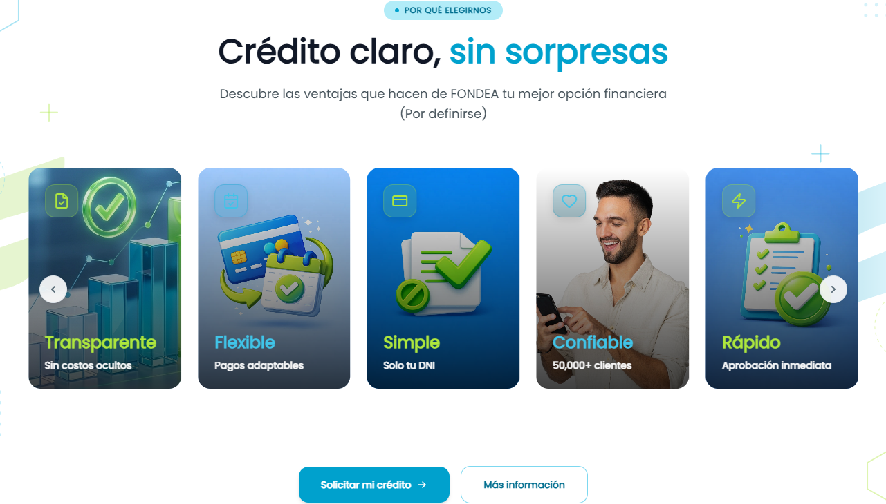

**Texto actual:**
- Eyebrow: "Por Qué Elegirnos"
- Título: "Crédito claro, sin sorpresas"
- Subtítulo: "Descubre las ventajas que hacen de FONDEA tu mejor opción financiera **(Por definirse)**" ⚠️ *placeholder pendiente*
- Tarjetas: "Rápido — Aprobación inmediata" / "Seguro — Encriptación bancaria" / "Transparente — Sin costos ocultos" / "Flexible — Pagos adaptables" / "Simple — Solo tu DNI" / "Confiable — 50,000+ clientes"
- Botones: "Solicitar mi crédito" / "Más información"

⚠️ **El subtítulo está marcado como "(Por definirse)" — prioritario.**

**Texto final:**
```
(completar aquí)
```

---

## 8. Niveles

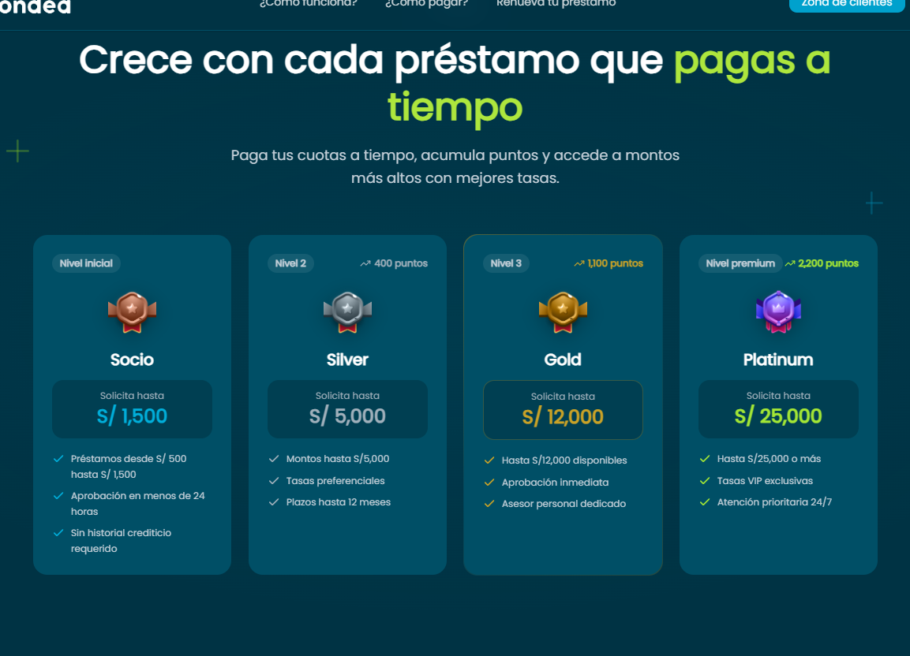

**Texto actual:**
- Eyebrow: "Niveles"
- Título: "Crece con cada préstamo que pagas a tiempo"
- Subtítulo: "Paga tus cuotas a tiempo, acumula puntos y accede a montos más altos con mejores tasas."
- Nivel "Socio" (inicial): "Solicita hasta S/ 1,500" — "Préstamos desde S/ 500 hasta S/ 1,500" / "Aprobación en menos de 24 horas" / "Sin historial crediticio requerido"
- Nivel "Silver" (400 puntos): "Solicita hasta S/ 5,000" — "Montos hasta S/5,000" / "Tasas preferenciales" / "Plazos hasta 12 meses"
- Nivel "Gold" (1,100 puntos): "Solicita hasta S/ 12,000" — "Hasta S/12,000 disponibles" / "Aprobación inmediata" / "Asesor personal dedicado"
- Nivel "Platinum" (2,200 puntos): "Solicita hasta S/ 25,000" — "Hasta S/25,000 o más" / "Tasas VIP exclusivas" / "Atención prioritaria 24/7"
- Botones: "Comenzar ahora" / "Más información"

**Texto final:**
```
(completar aquí)
```

---

## 9. Préstamos en Perú

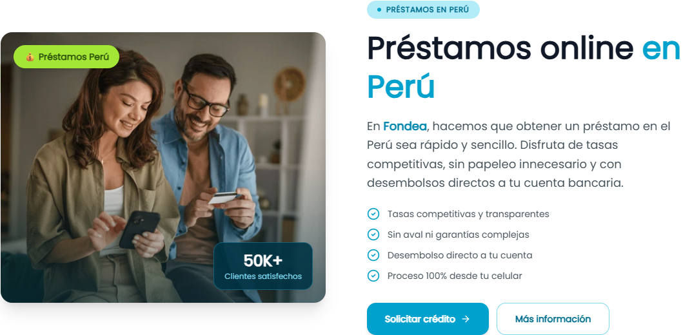

**Texto actual:**
- Tag imagen: "💰 Préstamos Perú" · "50K+ Clientes satisfechos"
- Eyebrow: "Préstamos en Perú"
- Título: "Préstamos online en Perú"
- Párrafo: "En Fondea, hacemos que obtener un préstamo en el Perú sea rápido y sencillo. Disfruta de tasas competitivas, sin papeleo innecesario y con desembolsos directos a tu cuenta bancaria."
- Bullets: "Tasas competitivas y transparentes" / "Sin aval ni garantías complejas" / "Desembolso directo a tu cuenta" / "Proceso 100% desde tu celular"
- Botones: "Solicitar crédito" / "Más información"

**Texto final:**
```
(completar aquí)
```

---

## 10. Colaboradores

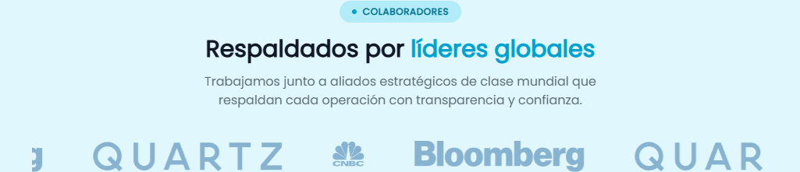

**Texto actual:**
- Eyebrow: "Colaboradores"
- Título: "Respaldados por líderes globales"
- Subtítulo: "Trabajamos junto a aliados estratégicos de clase mundial que respaldan cada operación con transparencia y confianza."
- Carrusel de 9 logos de colaboradores (sin nombres visibles en el snapshot, revisar con el cliente qué marcas van aquí)

**Texto final:**
```
(completar aquí)
```

---

## 11. Socios crediticios

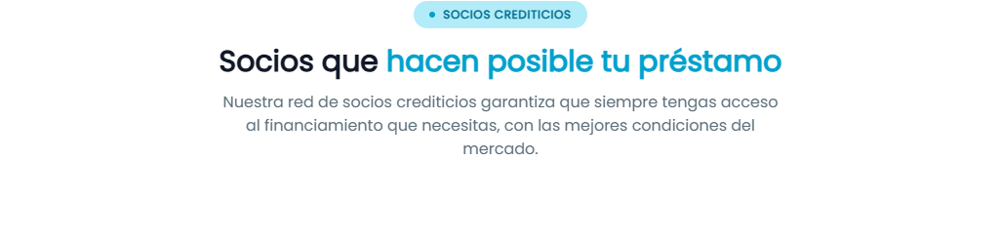

**Texto actual:**
- Eyebrow: "Socios crediticios"
- Título: "Socios que hacen posible tu préstamo"
- Subtítulo: "Nuestra red de socios crediticios garantiza que siempre tengas acceso al financiamiento que necesitas, con las mejores condiciones del mercado."
- Carrusel de 9 logos de socios

**Texto final:**
```
(completar aquí)
```

---

## 12. Testimonios

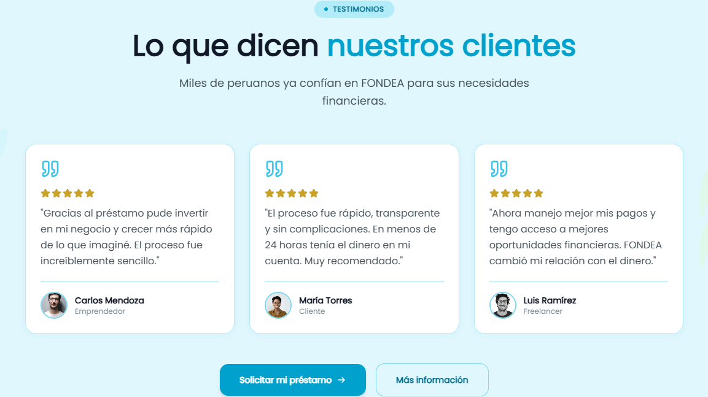

**Texto actual:**
- Eyebrow: "Testimonios"
- Título: "Lo que dicen nuestros clientes"
- Subtítulo: "Miles de peruanos ya confían en FONDEA para sus necesidades financieras."
- Testimonio 1: "Gracias al préstamo pude invertir en mi negocio y crecer más rápido de lo que imaginé. El proceso fue increíblemente sencillo." — Carlos Mendoza, Emprendedor
- Testimonio 2: "El proceso fue rápido, transparente y sin complicaciones. En menos de 24 horas tenía el dinero en mi cuenta. Muy recomendado." — María Torres, Cliente
- Testimonio 3: "Ahora manejo mejor mis pagos y tengo acceso a mejores oportunidades financieras. FONDEA cambió mi relación con el dinero." — Luis Ramírez, Freelancer
- Botones: "Solicitar mi préstamo" / "Más información"

⚠️ **Confirmar con el cliente si estos testimonios son reales/autorizados o son placeholders a reemplazar.**

**Texto final:**
```
(completar aquí)
```

---

## 13. Para qué usar tu préstamo

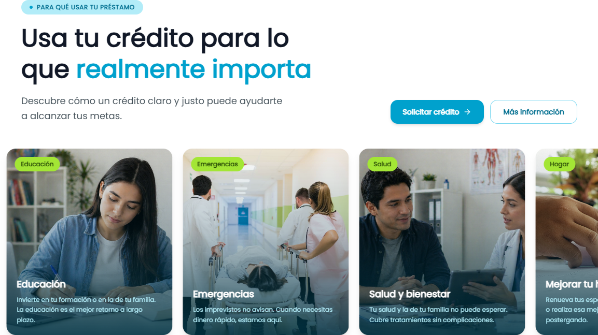

**Texto actual:**
- Eyebrow: "Para qué usar tu préstamo"
- Título: "Usa tu crédito para lo que realmente importa"
- Subtítulo: "Descubre cómo un crédito claro y justo puede ayudarte a alcanzar tus metas."
- Tarjetas (carrusel, se repiten 2 veces):
  - "Hogar" — "Mejorar tu hogar" — "Renueva tus espacios, repara lo que necesitas o realiza esa mejora que llevas tiempo postergando."
  - "Negocios" — "Impulsar tu negocio" — "Obtén el capital que necesitas para crecer, invertir en stock o aprovechar nuevas oportunidades."
  - "Metas" — "Cumplir tus metas" — "Ese proyecto personal que tienes en mente merece hacerse realidad."
  - "Educación" — "Educación" — "Invierte en tu formación o en la de tu familia. La educación es el mejor retorno a largo plazo."
  - "Emergencias" — "Emergencias" — "Los imprevistos no avisan. Cuando necesitas dinero rápido, estamos aquí."
  - "Salud" — "Salud y bienestar" — "Tu salud y la de tu familia no puede esperar. Cubre tratamientos sin complicaciones."
- Botones: "Solicitar crédito" / "Más información"

**Texto final:**
```
(completar aquí)
```

---

## 14. Preguntas frecuentes (FAQ)

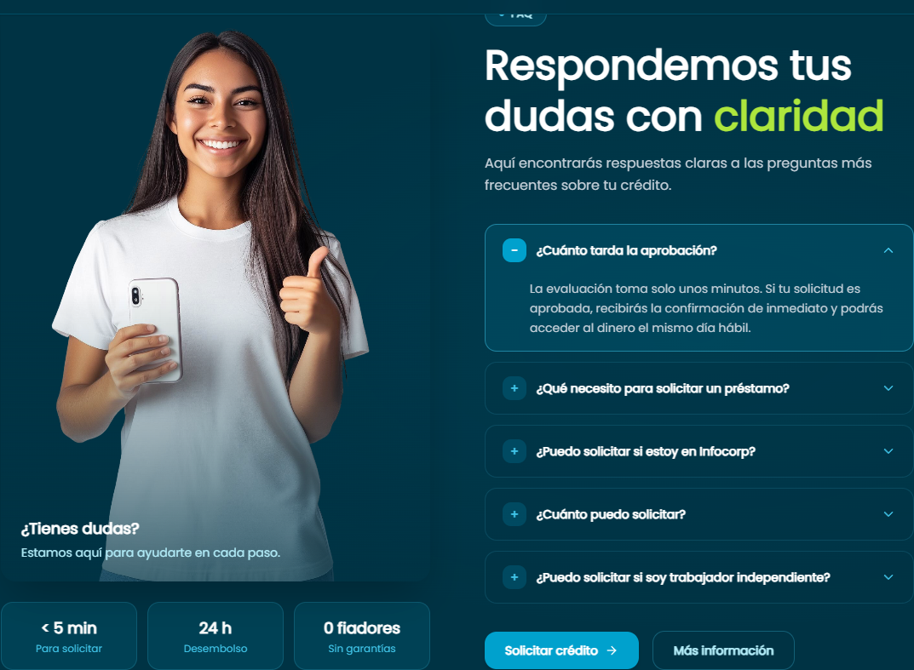

**Texto actual:**
- Eyebrow: "FAQ"
- Título: "Respondemos tus dudas con claridad"
- Subtítulo: "Aquí encontrarás respuestas claras a las preguntas más frecuentes sobre tu crédito."
- Panel lateral: "¿Tienes dudas? Estamos aquí para ayudarte en cada paso." / métricas "< 5 min Para solicitar" · "24 h Desembolso" · "0 fiadores Sin garantías"
- P1: "¿Cuánto tarda la aprobación?" — "La evaluación toma solo unos minutos. Si tu solicitud es aprobada, recibirás la confirmación de inmediato y podrás acceder al dinero el mismo día hábil."
- P2: "¿Qué necesito para solicitar un préstamo?" — "Solo necesitas tu DNI vigente, un número de celular activo a tu nombre y una cuenta bancaria peruana para recibir el desembolso. Sin cartas de trabajo, sin boletas de pago, sin fiadores."
- P3: "¿Puedo solicitar si estoy en Infocorp?" — "Evaluamos cada caso de forma individual. Tener deudas en centrales de riesgo no te descalifica automáticamente. Te recomendamos intentarlo — muchos clientes con historial imperfecto han sido aprobados."
- P4: "¿Cuánto puedo solicitar?" — "Los montos van desde S/ 500 hasta S/ 10,000 para nuevos clientes. A medida que acumulas puntos y subes de nivel, puedes acceder a montos mayores, hasta S/ 25,000 en nivel Platinum."
- P5: "¿Puedo solicitar si soy trabajador independiente?" — "Sí. No pedimos boletas de pago ni contratos laborales. Trabajadores independientes, emprendedores y dependientes pueden solicitar sin problema."
- Botones: "Solicitar crédito" / "Más información"

**Texto final:**
```
(completar aquí)
```

---

## 15. Contacto

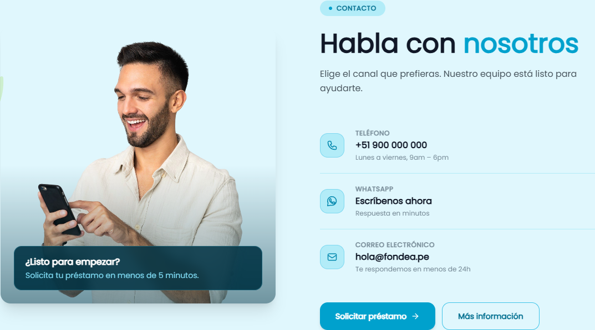

**Texto actual:**
- Panel lateral: "¿Listo para empezar? Solicita tu préstamo en menos de 5 minutos."
- Eyebrow: "Contacto"
- Título: "Habla con nosotros"
- Subtítulo: "Elige el canal que prefieras. Nuestro equipo está listo para ayudarte."
- Teléfono: "+51 900 000 000" — "Lunes a viernes, 9am – 6pm" ⚠️ *parece número placeholder*
- WhatsApp: "Escríbenos ahora" — "Respuesta en minutos"
- Correo: "hola@fondea.pe" — "Te respondemos en menos de 24h"
- Botones: "Solicitar préstamo" / "Más información"

⚠️ **El teléfono +51 900 000 000 parece un valor de prueba — confirmar el número real.**

**Texto final:**
```
(completar aquí)
```

---

## 16. Blog

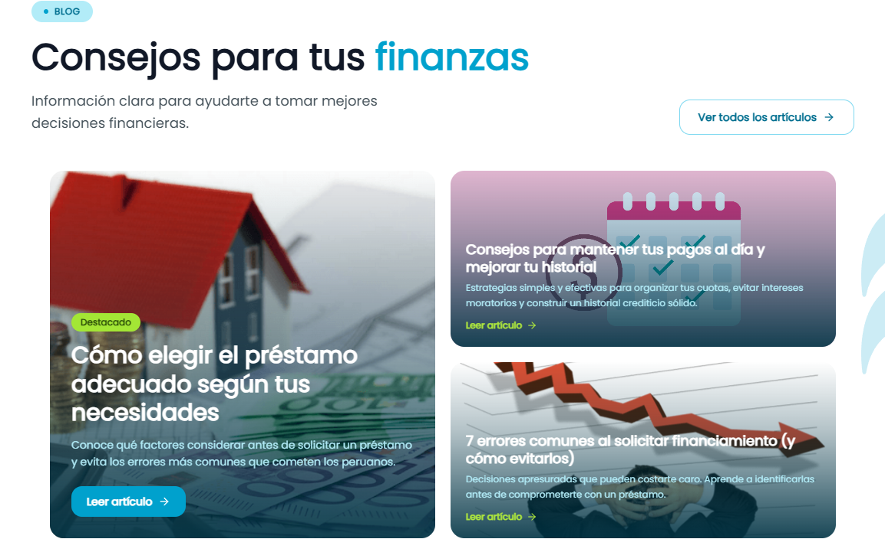

**Texto actual:**
- Eyebrow: "Blog"
- Título: "Consejos para tus finanzas"
- Subtítulo: "Información clara para ayudarte a tomar mejores decisiones financieras."
- Link: "Ver todos los artículos"
- Artículo destacado: "Cómo elegir el préstamo adecuado según tus necesidades" — "Conoce qué factores considerar antes de solicitar un préstamo y evita los errores más comunes que cometen los peruanos."
- Artículo 2: "Consejos para mantener tus pagos al día y mejorar tu historial" — "Estrategias simples y efectivas para organizar tus cuotas, evitar intereses moratorios y construir un historial crediticio sólido."
- Artículo 3: "7 errores comunes al solicitar financiamiento (y cómo evitarlos)" — "Decisiones apresuradas que pueden costarte caro. Aprende a identificarlas antes de comprometerte con un préstamo."

**Texto final:**
```
(completar aquí)
```

---

## 17. CTA final

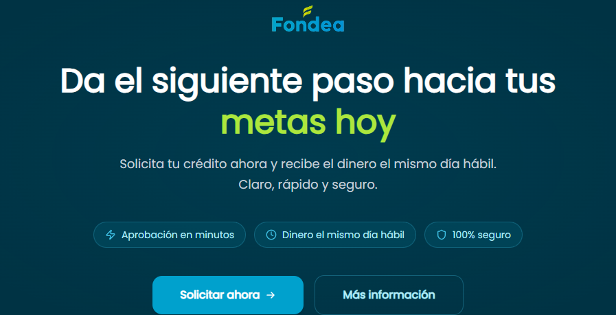

**Texto actual:**
- Título: "Da el siguiente paso hacia tus metas hoy"
- Párrafo: "Solicita tu crédito ahora y recibe el dinero el mismo día hábil. Claro, rápido y seguro."
- Bullets: "Aprobación en minutos" / "Dinero el mismo día hábil" / "100% seguro"
- Botones: "Solicitar ahora" / "Más información"

**Texto final:**
```
(completar aquí)
```

---

## 18. Footer

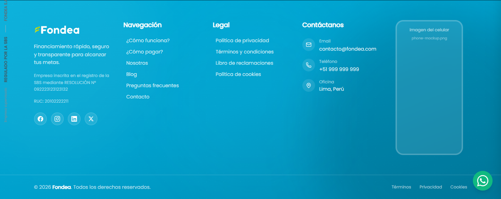

**Texto actual:**
- Descripción: "Financiamiento rápido, seguro y transparente para alcanzar tus metas."
- Legal: "Empresa inscrita en el registro de la SBS mediante RESOLUCIÓN N° 092223123123132" ⚠️ *parece placeholder*
- RUC: "20102222211" ⚠️ *parece placeholder*
- Redes sociales: Facebook / Instagram / LinkedIn / Twitter (enlaces "#" sin definir)
- Navegación: ¿Cómo funciona? / ¿Cómo pagar? / Nosotros / Blog / Preguntas frecuentes / Contacto
- Legal: Política de privacidad / Términos y condiciones / Libro de reclamaciones / Política de cookies
- Contacto: Email "contacto@fondea.com" ⚠️ *distinto al de la sección Contacto (hola@fondea.pe), confirmar cuál es el correcto* — Teléfono "+51 999 999 999" ⚠️ *placeholder* — Oficina "Lima, Perú"
- Copyright: "© 2026 Fondea. Todos los derechos reservados."
- Barra inferior: "Regulado por la SBS" / "FONDEA S.A.C." / "Registro N° 00000" ⚠️ *placeholder* / "Empresa supervisada"

⚠️ **Varios datos legales (RUC, N° de resolución SBS, N° de registro, teléfono, email) parecen ser placeholders — es importante que el cliente confirme los datos reales de la empresa antes de publicar.**

**Texto final:**
```
(completar aquí)
```

---
<!-- 
## Resumen de pendientes prioritarios

- [ ] Sección 6 (Métodos de Pago): título marcado "(POR DEFINIR)"
- [ ] Sección 7 (Por Qué Elegirnos): subtítulo marcado "(Por definirse)"
- [ ] Sección 12 (Testimonios): confirmar si son reales o placeholders
- [ ] Sección 15 (Contacto): confirmar teléfono real
- [ ] Sección 18 (Footer): confirmar RUC, N° de resolución SBS, N° de registro, teléfono y email reales (hay inconsistencia entre el email del footer y el de la sección Contacto) -->
